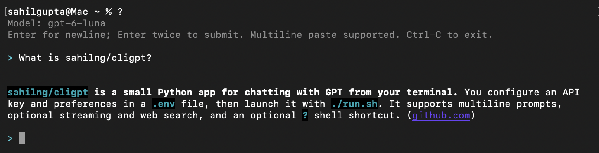

# cligpt (aka ?)

*A quick and easy way to use GPT in the Terminal.*

## Usage

1. Install Python 3 with `pip` and `venv` support, then open a terminal in this repository.
2. Copy the example configuration with `cp .env.example .env`. Edit `.env` to set your API key, model, reasoning effort, streaming, and web-search preferences.
3. Run `./run.sh` to launch cligpt. It creates a virtual environment if needed and installs dependencies automatically.
4. To add the optional `?` shortcut, exit cligpt with `Ctrl-C`, then run `source shortcut.sh` from the repository in Bash or Zsh. This adds the alias to your shell configuration and activates it in the current shell.
5. Use `?` in your terminal to launch cligpt from anywhere.

Set `MARKDOWN=false` to disable terminal markdown rendering. When `STREAM=true` and markdown rendering is enabled, responses render after completion so lists, code blocks, and tables format correctly.

Code blocks render without extra padding and preserve their original line breaks and indentation for copying into a shell. Long code lines wrap visually in the terminal without inserting extra newlines.

Set `REASONING_EFFORT` to a value supported by your model, such as `low`, `medium`, or `high`. If it is missing or blank, the app uses `low`.

If the API key is missing, the CLI asks for it without echoing it or adding it to line-editing history. Request failures return you to the prompt; failed or incomplete turns are excluded from conversation context.

### Key bindings

| Key | Action |
|-----|--------|
| `Enter` | Accept the current line and continue on the next line |
| `Enter` twice | Submit, keeping the newline from the first press |
| `\` then `Enter` | Insert a newline and remove the backslash; the next `Enter` also inserts a newline (use for blank lines) |
| Paste | Insert text, preserving newlines; press `Enter` twice afterward to submit |
| `Ctrl-C` | Exit |

Input uses Python's native line editor (`readline`), with normal terminal scrollback. Edit the current line with the usual shell shortcuts and use up/down for history. Once you press Enter, that line becomes terminal output; an empty continuation line submits the message. Ctrl-C exits and leaves the conversation visible.

On terminals with readline bracketed-paste support, paste normally, review the text, then press Enter twice to send. Esc/Alt+Enter immediate submission is no longer a custom binding; modified keys follow your native line editor's configuration.

GNU readline may turn CRLF line endings in pasted Windows text into extra blank lines. Paste text with LF line endings to preserve its exact spacing. Without bracketed-paste support, pasted blank lines can submit a message early.

